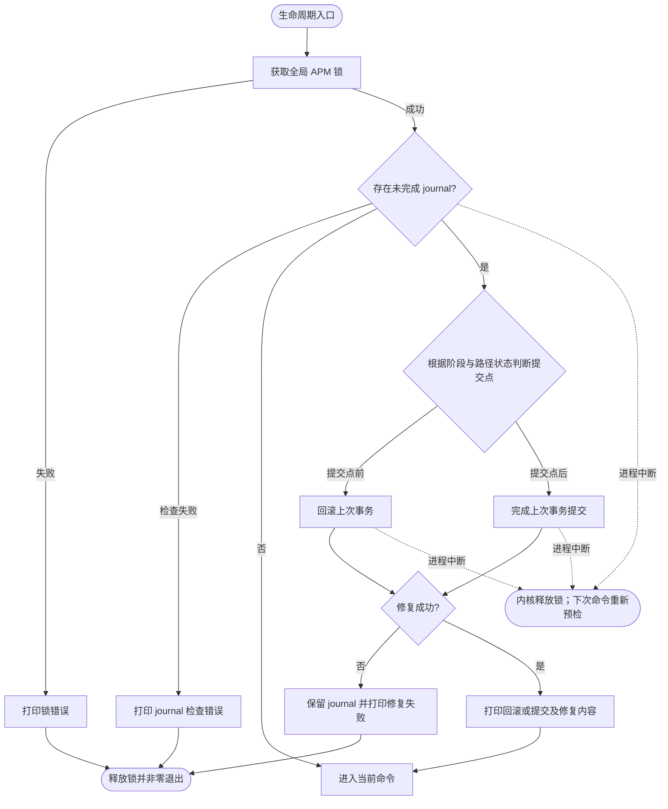

# APM CLI Lifecycle Flow Diagrams Implementation Plan

> **For agentic workers:** REQUIRED SUB-SKILL: Use superpowers:subagent-driven-development (recommended) or superpowers:executing-plans to implement this plan task-by-task. Steps use checkbox (`- [ ]`) syntax for tracking.

**Goal:** Record the approved APM lifecycle decisions, add one Mermaid lifecycle flowchart per CLI command, and expose all four diagrams through the Core Lifecycle component properties.

**Architecture:** Keep the existing Core Lifecycle C4 component and store each command flow as a focused `.mmd` file in a new sibling directory. Record cross-command locking and journal recovery in ADR-003, keep CLI syntax in ADR-002, and synchronize the project overview and existing class diagrams so every design artifact states the same semantics.

**Tech Stack:** Markdown, Structurizr DSL, Mermaid flowcharts/class diagrams, `rg`, Mermaid CLI through `npx`, Structurizr CLI through Docker.

## Global Constraints

- This is design-document maintenance only; do not create or modify Go implementation or test files.
- Do not create an Ivory Tower feature directory; keep this plan under `docs/superpowers/plans/`.
- All four commands acquire the global APM lock at lifecycle entry and hold it through journal preflight and command completion.
- Normal supported state permits at most one unfinished journal; do not diagram recovery from multiple journals, manual state tampering, old-version defects, or disk corruption.
- Journal recovery failure prints the error, preserves the journal, exits nonzero, and does not run the requested command.
- Install publishes by atomic staging-to-target rename; uninstall commits by atomic target-to-quarantine move.
- `install --agent=all` and `uninstall --agent=all` are serial and fail-fast; `list --installed --agent=all` continues reads and aggregates per-Agent failures.
- Preserve unrelated working-tree changes. In particular, inspect the pre-existing edit to `ivory-tower/c4/components/apm-cli-diagrams/core-lifecycle.mmd` before changing or staging that file.
- Do not add `docs/Changelog.md`; documentation-only changes do not meet the project changelog threshold.

---

## File Map

| Path | Responsibility |
| --- | --- |
| `ivory-tower/adr/ADR-003-serialize-lifecycle-and-recover-journal.md` | Cross-command lock, journal, commit-point recovery, logging, and fail-fast decisions. |
| `ivory-tower/adr/ADR-002-cli-agent-and-power-type-as-flags.md` | CLI syntax for search/list/install/uninstall, including versions and `--installed`. |
| `ivory-tower/project-overview.md` | Current architecture snapshot and links to ADR-001/002/003. |
| `ivory-tower/c4/components/apm-cli-lifecycle-diagrams/search.mmd` | Search preflight, cloud query, failure, and interruption flow. |
| `ivory-tower/c4/components/apm-cli-lifecycle-diagrams/list.mmd` | Cloud-list and installed-list branches, including per-Agent aggregation. |
| `ivory-tower/c4/components/apm-cli-lifecycle-diagrams/install.mmd` | Version resolution, cache/staging, atomic publish, rollback/commit completion, and fail-fast flow. |
| `ivory-tower/c4/components/apm-cli-lifecycle-diagrams/uninstall.mmd` | Idempotent absence, atomic quarantine, rollback/commit completion, and fail-fast flow. |
| `ivory-tower/c4/components/apm-cli.dsl` | Core Lifecycle properties and corrected CLI/lock descriptions. |
| `ivory-tower/c4/components/apm-cli-diagrams/cli-entry.mmd` | CLI flags and result types matching the approved command semantics. |
| `ivory-tower/c4/components/apm-cli-diagrams/core-lifecycle.mmd` | Common lock/recovery orchestration and journal dependency. |
| `ivory-tower/c4/components/apm-cli-diagrams/lock-manager.mmd` | Global lock scope across all four commands. |

---

### Task 1: Record the lifecycle and CLI decisions

**Files:**
- Create: `ivory-tower/adr/ADR-003-serialize-lifecycle-and-recover-journal.md`
- Modify: `ivory-tower/adr/ADR-002-cli-agent-and-power-type-as-flags.md:18`
- Modify: `ivory-tower/project-overview.md:17`

**Interfaces:**
- Consumes: Approved design in `docs/superpowers/specs/2026-08-04-apm-cli-lifecycle-flow-diagrams-design.md`.
- Produces: ADR-003 as the authoritative lifecycle transaction decision; ADR-002 as the authoritative CLI syntax decision; project-overview links used by later diagram reviews.

- [ ] **Step 1: Confirm the three source documents and working tree**

Run:

```bash
git status --short
sed -n '1,260p' docs/superpowers/specs/2026-08-04-apm-cli-lifecycle-flow-diagrams-design.md
sed -n '1,240p' ivory-tower/adr/ADR-002-cli-agent-and-power-type-as-flags.md
sed -n '1,180p' ivory-tower/project-overview.md
```

Expected: the approved spec is present; ADR-002 still contains the old continue-after-Agent-failure rule; the existing uncommitted class-diagram edit remains untouched.

- [ ] **Step 2: Create ADR-003 with the accepted decision**

Create `ivory-tower/adr/ADR-003-serialize-lifecycle-and-recover-journal.md` with these exact decision boundaries:

```markdown
# Architecture Decision Record

- Status：Accepted
- Date：2026-08-04
- Decision Makers：liangjunzhao

## Context

APM 要求任意命令启动时都能识别并纠正上一次 install/uninstall 中断留下的不一致状态。只让写命令持锁会使 search/list 在 journal 修复期间产生并发写入风险；`--agent=all` 在错误后继续也会与“至多一个未完成 journal”冲突。

本 ADR 补充 [ADR-001](ADR-001-use-go-as-implementation-language.md) 的 staging、原子 rename 与 journal 技术选择，并约束 [ADR-002](ADR-002-cli-agent-and-power-type-as-flags.md) 的多 Agent 执行语义。

## Decision

四条生命周期命令 search/list/install/uninstall 在入口获取同一把全局 APM 锁，并持有到 journal 预检、用户命令和结果输出全部结束。

正常受支持状态至多存在一个未完成 journal。每条命令在执行用户请求前检查该 journal：提交点前执行回滚，提交点后完成提交；修复成功后打印修复方向与内容并继续原命令，修复失败则保留 journal、打印错误并非零退出。

install 在原子 staging-to-target rename 前记录 publishing 意图，该 rename 是提交点。uninstall 在原子 target-to-quarantine move 前记录 removing 意图，该 move 是提交点。恢复时结合 journal 阶段和 staging、target、backup/quarantine 路径状态覆盖“原子操作完成但阶段尚未更新”的中断窗口。

install/uninstall 的 `--agent=all` 按 Agent 串行且 fail-fast：任一 Agent 错误后停止剩余 Agent并非零退出。`list --installed --agent=all` 是只读汇总，单个 Agent 读取失败不阻止读取其他 Agent，但最终整体非零退出。

恢复日志至少包含原操作、Agent、Power、版本、原阶段、回滚或完成提交、修复内容和结果。

## Consequences

- 正面影响：所有命令看到一致的本地状态；中断恢复方向确定；不会在错误 journal 未解决时创建第二个事务。
- 代价与风险：search/list 也被全局锁串行化；`--agent=all` 的 install/uninstall 可能产生“部分完成、其余未执行”的结果。
- 后续动作：在 Core Lifecycle 的四张命令流程图、C4 properties、类图和项目概览中引用并表达本决策。

## Alternatives Considered

| 方案 | 未选择原因 |
| --- | --- |
| 仅 install/uninstall 持锁 | search/list 的启动修复会写本地状态，不能在无锁状态安全执行。 |
| 仅在修复时临时加锁 | 锁范围分裂，命令状态可能在预检后被另一进程改变。 |
| `--agent=all` 单 Agent 失败后继续 | 未解决 journal 存在时无法安全创建下一事务，破坏单 journal 不变量。 |
| 所有阶段一律回滚或一律继续 | 无法同时保证原子提交点前恢复旧状态和提交点后补全一致性。 |
```

- [ ] **Step 3: Update ADR-002 CLI syntax and cross-reference ADR-003**

Replace the generic syntax and ambiguous `name` text with:

```text
apm search <keyword> --agent=<agent-id|all> [--type=<skill|plugin|mcp>]
apm list --agent=<agent-id|all> [--type=<skill|plugin|mcp>] [--installed]
apm install <power>[=<version>] --agent=<agent-id|all> [--type=<skill|plugin|mcp>]
apm uninstall <power> --agent=<agent-id|all> [--type=<skill|plugin|mcp>]
```

State explicitly below the syntax:

```markdown
- `search` 的 keyword 必填，只查询云端资源。
- `list` 默认列出云端资源；`--installed` 改为读取本地安装清单。
- `install` 未指定版本时选择云端最新版；显式 `<power>=<version>` 可安装、升级或降级到指定版本；相同版本视为成功且不重复安装。
- `uninstall` 未找到本地安装记录时视为幂等成功；同名跨类别歧义要求显式 `--type`。
```

Replace the old `--agent=all` continue-on-error paragraph with a concise cross-reference: install/uninstall are serial and fail-fast under ADR-003; `list --installed` continues per-Agent reads and aggregates failures.

- [ ] **Step 4: Synchronize the project overview**

Update the Scope and Architecture Snapshot so they state:

```markdown
- `search <keyword>` 搜索云端资源；`list` 默认列出云端资源，`list --installed` 列出本地安装清单。
- `install <power>[=<version>]` 未指定版本时选择云端最新版，相同版本幂等成功，不同版本执行升级或显式降级。
- 四条命令均在全局锁内先检查唯一活动 journal；提交点前回滚，提交点后完成提交，修复失败则非零退出。
```

Link CLI syntax to ADR-002 and lifecycle recovery to `adr/ADR-003-serialize-lifecycle-and-recover-journal.md`. Remove the resolved “失败恢复机制未确定” risk while retaining unresolved compatibility, conflict, permission, and audit concerns.

- [ ] **Step 5: Verify decision-document consistency**

Run:

```bash
rg -n "单个 Agent 失败不影响|install/uninstall期间持有|search/list 可省略|失败恢复机制未确定" ivory-tower/adr ivory-tower/project-overview.md
rg -n "ADR-003|--installed|<power>\[=<version>\]|fail-fast|全局.*锁" ivory-tower/adr ivory-tower/project-overview.md
git diff --check
```

Expected: the first command returns no stale lifecycle claim; the second finds all new decisions and links; `git diff --check` is silent.

- [ ] **Step 6: Commit the decision documents**

```bash
git add ivory-tower/adr/ADR-002-cli-agent-and-power-type-as-flags.md \
  ivory-tower/adr/ADR-003-serialize-lifecycle-and-recover-journal.md \
  ivory-tower/project-overview.md
git diff --cached --check
git commit -m "docs(adr): define serialized lifecycle recovery"
```

Expected: one documentation commit containing only ADR-002, ADR-003, and the project overview.

---

### Task 2: Add and mount the four command lifecycle diagrams

**Files:**
- Create: `ivory-tower/c4/components/apm-cli-lifecycle-diagrams/search.mmd`
- Create: `ivory-tower/c4/components/apm-cli-lifecycle-diagrams/list.mmd`
- Create: `ivory-tower/c4/components/apm-cli-lifecycle-diagrams/install.mmd`
- Create: `ivory-tower/c4/components/apm-cli-lifecycle-diagrams/uninstall.mmd`
- Modify: `ivory-tower/c4/components/apm-cli.dsl:8`

**Interfaces:**
- Consumes: ADR-002 command syntax and ADR-003 lock/journal semantics from Task 1.
- Produces: Four pure Mermaid flowcharts addressed by the Core Lifecycle properties `searchLifecycle`, `listLifecycle`, `installLifecycle`, and `uninstallLifecycle`.

- [ ] **Step 1: Add the shared preflight shape to each diagram**

Each file must begin with `flowchart TD` and independently contain these nodes and outcomes; do not factor the common flow into another file because every property must point to a self-contained Mermaid document:



Use command-specific node IDs instead of duplicating an ID within a file. Every diagram must show that the global lock remains held until a normal or error terminal; release may be stated in terminal-node labels.

- [ ] **Step 2: Complete `search.mmd`**

After the shared `Command` node, add this exact decision flow:

```mermaid
    Command --> Validate[校验必填 keyword、agent 与 type]
    Validate -->|失败| SearchFail[打印参数或 Agent/Adapter 错误] --> ExitError
    Validate -->|成功| CloudSearch[调用云端列表接口并按 keyword 及 flags 过滤]
    CloudSearch -->|请求或解析失败| SearchFail
    CloudSearch -->|成功| Print[打印匹配的云端 Power]
    Print --> ExitOK([释放锁并正常退出])
    Validate -.进程中断.-> Interrupted
    CloudSearch -.进程中断.-> Interrupted
    Print -.进程中断.-> Interrupted
```

The diagram must not create a new journal or imply local-state writes after preflight.

- [ ] **Step 3: Complete `list.mmd`**

After the shared `Command` node, add these branches:

```mermaid
    Command --> Validate[校验 agent、type 与 installed flag]
    Validate -->|失败| ListFail[打印参数或 Agent 错误] --> ExitError
    Validate -->|成功| Installed{指定 --installed?}
    Installed -->|否| CloudList[调用云端接口列出并过滤资源]
    CloudList -->|失败| ListFail
    CloudList -->|成功| PrintCloud[打印云端 Power] --> ExitOK([释放锁并正常退出])
    Installed -->|是| All{agent 等于 all?}
    All -->|否| ReadOne[读取目标 Agent 安装清单]
    ReadOne -->|文件不存在| EmptyOne[打印空列表] --> ExitOK
    ReadOne -->|读取或解析失败| ListFail
    ReadOne -->|成功| PrintOne[打印已安装 Power] --> ExitOK
    All -->|是| NextAgent{还有 Agent?}
    NextAgent -->|是| ReadAgent[读取该 Agent 安装清单]
    ReadAgent -->|文件不存在| RecordEmpty[记录该 Agent 空列表] --> NextAgent
    ReadAgent -->|读取或解析失败| RecordFailure[记录该 Agent 失败] --> NextAgent
    ReadAgent -->|成功| RecordList[记录该 Agent 已安装列表] --> NextAgent
    NextAgent -->|否| AnyFailure{存在读取失败?}
    AnyFailure -->|否| PrintAll[按 Agent 分组打印结果] --> ExitOK
    AnyFailure -->|是| PrintPartial[打印分组结果与失败汇总] --> ExitError
    CloudList -.进程中断.-> Interrupted
    Validate -.进程中断.-> Interrupted
    ReadOne -.进程中断.-> Interrupted
    ReadAgent -.进程中断.-> Interrupted
```

The default branch must be cloud-backed; only `--installed` may read manifests.

- [ ] **Step 4: Complete `install.mmd`**

After the shared `Command` node, express the install transaction with these nodes and transitions:

```mermaid
    Command --> Resolve[解析 power 与可选 version；获取元数据和 Adapter]
    Resolve -->|失败| InstallFail[打印失败阶段与原因] --> BatchError([停止剩余 Agent；释放锁；非零退出])
    Resolve -->|成功| NextAgent{还有目标 Agent?}
    NextAgent -->|否| InstallOK([释放锁并正常退出])
    NextAgent -->|是| ReadManifest[读取该 Agent 安装清单]
    ReadManifest -->|失败| InstallFail
    ReadManifest -->|成功| Same{已安装目标版本?}
    Same -->|是| Skip[打印相同版本，幂等成功] --> NextAgent
    Same -->|否| CreateJournal[创建 install journal]
    CreateJournal -->|失败| InstallFail
    CreateJournal -->|成功| Cache[校验缓存；缺失则临时下载、校验并原子入缓存]
    Cache -->|失败| Rollback[提交点前回滚临时文件、staging 与旧版本]
    Cache -->|成功| Stage[在 staging 中转换并准备安装内容]
    Stage -->|失败| Rollback
    Stage -->|成功| Existing{存在旧版本?}
    Existing -->|是| Backup[原子移动旧版本到事务备份]
    Backup -->|失败| Rollback
    Existing -->|否| Intent[持久化 publishing 意图]
    Backup -->|成功| Intent
    Intent -->|失败| Rollback
    Intent -->|成功| Publish[[原子 rename staging 到正式路径：提交点]]
    Publish -->|未越过提交点| Rollback
    Publish -->|已越过提交点| Register[补全 Adapter 注册]
    Register -->|失败| FinishCommit[完成注册、清单与清理]
    Register -->|成功| Manifest[原子更新安装清单]
    Manifest -->|失败| FinishCommit
    Manifest -->|成功| Cleanup[清理备份、临时文件与 journal]
    Cleanup -->|失败| FinishCommit
    Cleanup -->|成功| Installed[打印首次安装、升级或降级成功] --> NextAgent
    Rollback --> RollbackOK{回滚成功?}
    RollbackOK -->|是| RolledBack[删除 journal；打印回滚内容] --> BatchError
    RollbackOK -->|否| KeepRollback[保留 journal；打印回滚失败] --> BatchError
    FinishCommit --> CommitOK{提交补全成功?}
    CommitOK -->|是| Committed[删除 journal；打印完成提交内容] --> BatchError
    CommitOK -->|否| KeepCommit[保留 journal；打印提交补全失败] --> BatchError
    Resolve -.进程中断.-> Interrupted
    ReadManifest -.进程中断.-> Interrupted
    CreateJournal -.进程中断.-> Interrupted
    Cache -.进程中断.-> Interrupted
    Stage -.进程中断.-> Interrupted
    Backup -.进程中断.-> Interrupted
    Intent -.进程中断.-> Interrupted
    Publish -.进程中断.-> Interrupted
    Register -.进程中断.-> Interrupted
    Manifest -.进程中断.-> Interrupted
    Cleanup -.进程中断.-> Interrupted
```

Label version resolution nearby: omitted version means cloud latest; explicit older version is a downgrade; same target version is success. A command-stage error always reaches `BatchError`, even when immediate rollback or commit completion succeeds, because `--agent=all` is fail-fast.

- [ ] **Step 5: Complete `uninstall.mmd`**

After the shared `Command` node, express the uninstall transaction with these nodes and transitions:

```mermaid
    Command --> NextAgent{还有目标 Agent?}
    NextAgent -->|否| UninstallOK([释放锁并正常退出])
    NextAgent -->|是| Find[从该 Agent 清单按 power 与可选 type 定位记录]
    Find -->|读取失败或类型歧义| UninstallFail[打印失败阶段与原因] --> BatchError([停止剩余 Agent；释放锁；非零退出])
    Find -->|未安装| Skip[打印未安装、无需处理] --> NextAgent
    Find -->|已安装| Adapter[解析 Adapter]
    Adapter -->|失败| UninstallFail
    Adapter -->|成功| CreateJournal[创建 uninstall journal]
    CreateJournal -->|失败| UninstallFail
    CreateJournal -->|成功| Intent[持久化 removing 意图]
    Intent -->|失败| Rollback[提交点前恢复原状态]
    Intent -->|成功| Quarantine[[原子移动正式内容到隔离目录：提交点]]
    Quarantine -->|未越过提交点| Rollback
    Quarantine -->|已越过提交点| Unregister[补全 Adapter 注销]
    Unregister -->|失败| FinishCommit[完成注销、清单删除与清理]
    Unregister -->|成功| Manifest[原子删除安装清单记录]
    Manifest -->|失败| FinishCommit
    Manifest -->|成功| Cleanup[清理隔离内容与 journal]
    Cleanup -->|失败| FinishCommit
    Cleanup -->|成功| Removed[打印卸载成功] --> NextAgent
    Rollback --> RollbackOK{回滚成功?}
    RollbackOK -->|是| RolledBack[删除 journal；打印回滚内容] --> BatchError
    RollbackOK -->|否| KeepRollback[保留 journal；打印回滚失败] --> BatchError
    FinishCommit --> CommitOK{提交补全成功?}
    CommitOK -->|是| Committed[删除 journal；打印完成提交内容] --> BatchError
    CommitOK -->|否| KeepCommit[保留 journal；打印提交补全失败] --> BatchError
    Find -.进程中断.-> Interrupted
    Adapter -.进程中断.-> Interrupted
    CreateJournal -.进程中断.-> Interrupted
    Intent -.进程中断.-> Interrupted
    Quarantine -.进程中断.-> Interrupted
    Unregister -.进程中断.-> Interrupted
    Manifest -.进程中断.-> Interrupted
    Cleanup -.进程中断.-> Interrupted
```

The diagram must not call the cloud service. A missing local record is an idempotent success; all real errors are fail-fast.

- [ ] **Step 6: Mount the four files on Core Lifecycle**

Extend only the existing `lifecycle` properties block in `ivory-tower/c4/components/apm-cli.dsl`:

```text
properties {
    "classDiagram" "apm-cli-diagrams/core-lifecycle.mmd"
    "searchLifecycle" "apm-cli-lifecycle-diagrams/search.mmd"
    "listLifecycle" "apm-cli-lifecycle-diagrams/list.mmd"
    "installLifecycle" "apm-cli-lifecycle-diagrams/install.mmd"
    "uninstallLifecycle" "apm-cli-lifecycle-diagrams/uninstall.mmd"
}
```

Also update the `cliEntry` component description to:

```text
cobra 命令路由，解析 keyword/power/version、--agent/--type/--installed 并触发对应生命周期用例。
```

Do not add lifecycle properties to CLI Entry, Adapter Registry, Config Model, Lock Manager, Cache Manager, or Cloud Client.

- [ ] **Step 7: Render all four Mermaid diagrams**

Run:

```bash
mkdir -p /tmp/apm-lifecycle-mermaid
for source in ivory-tower/c4/components/apm-cli-lifecycle-diagrams/*.mmd; do
  output="/tmp/apm-lifecycle-mermaid/$(basename "${source%.mmd}").svg"
  npx --yes @mermaid-js/mermaid-cli -i "$source" -o "$output"
done
find /tmp/apm-lifecycle-mermaid -maxdepth 1 -type f -name '*.svg' -size +0c -print | sort
```

Expected: Mermaid CLI exits zero four times and the final command prints exactly four non-empty SVG paths.

- [ ] **Step 8: Validate property targets and Structurizr DSL**

Run:

```bash
for key in search list install uninstall; do
  test -f "ivory-tower/c4/components/apm-cli-lifecycle-diagrams/$key.mmd"
  rg -q "\"${key}Lifecycle\" \"apm-cli-lifecycle-diagrams/${key}.mmd\"" ivory-tower/c4/components/apm-cli.dsl
done
docker run --rm -v "$PWD/ivory-tower/c4:/usr/local/structurizr" structurizr/cli validate -workspace workspace.dsl
git diff --check
```

Expected: all path checks exit zero; Structurizr reports a valid workspace; `git diff --check` is silent.

- [ ] **Step 9: Commit the lifecycle diagrams and properties**

```bash
git add ivory-tower/c4/components/apm-cli.dsl \
  ivory-tower/c4/components/apm-cli-lifecycle-diagrams/search.mmd \
  ivory-tower/c4/components/apm-cli-lifecycle-diagrams/list.mmd \
  ivory-tower/c4/components/apm-cli-lifecycle-diagrams/install.mmd \
  ivory-tower/c4/components/apm-cli-lifecycle-diagrams/uninstall.mmd
git diff --cached --check
git commit -m "docs(c4): add CLI lifecycle flow diagrams"
```

Expected: the commit contains exactly the four new `.mmd` files and `apm-cli.dsl`.

---

### Task 3: Synchronize class diagrams and run final verification

**Files:**
- Modify: `ivory-tower/c4/components/apm-cli-diagrams/cli-entry.mmd:1`
- Modify: `ivory-tower/c4/components/apm-cli-diagrams/core-lifecycle.mmd:1`
- Modify: `ivory-tower/c4/components/apm-cli-diagrams/lock-manager.mmd:1`

**Interfaces:**
- Consumes: ADR-002 syntax, ADR-003 lifecycle semantics, and the four lifecycle property names from Tasks 1–2.
- Produces: Class diagrams whose flags, list result, lock scope, recovery dependency, and multi-Agent notes agree with the flowcharts.

- [ ] **Step 1: Inspect and preserve the existing uncommitted Core Lifecycle edit**

Run:

```bash
git status --short
git diff -- ivory-tower/c4/components/apm-cli-diagrams/core-lifecycle.mmd
```

Expected: review the user-owned edit changing the Locker note to “全局 APM 文件锁”. Keep that intent while extending the file; do not discard or overwrite unrelated lines.

- [ ] **Step 2: Update CLI Entry types and signatures**

Change `Flags` to expose the approved semantics:

```mermaid
class Flags {
    +Agent string
    +Type string
    +Name string
    +Version string
    +Keyword string
    +Installed bool
}
```

Update its note to state that install parses `<power>[=<version>]`, search requires `Keyword`, and list uses `Installed`. Add a result type that can represent either cloud or installed listings:

```mermaid
class ListResult {
    +CloudPowers []PowerRef
    +InstalledByAgent map~AgentID, []InstalledPower~
    +Failures map~AgentID, error~
}
```

Change the interface method to `+List(Flags) (ListResult, error)` and add `Lifecycle --> ListResult : returns`. Keep the other three method signatures and existing CLI relationships.

- [ ] **Step 3: Update Core Lifecycle orchestration and journal dependency**

Change the Lifecycle `List` return type to `(ListResult, error)`. Replace the service note with:

```text
四个命令先取全局锁并修复唯一活动 journal；install/uninstall 以原子文件操作为提交点，--agent=all 串行且失败即停
```

Add the journal abstraction:

```mermaid
class JournalStore {
    <<interface>>
    +Inspect() (Journal, error)
    +Write(Journal) error
    +Delete() error
}
```

Add `lifecycleService --> JournalStore`. Update the Locker note to “四个生命周期命令从启动预检到结束全程持有的全局 APM 文件锁”. Retain all existing AdapterRegistry, ConfigStore, PowerCache, and CloudClient dependencies.

- [ ] **Step 4: Correct Lock Manager scope**

Replace the opening note with:

```text
全局 APM 锁：search/list/install/uninstall 从 journal 预检到命令结束全程持有，整个 APM 串行化
```

Keep `Acquire() (Unlock, error)`, kernel crash release behavior, the single global lock file, and all relationships unchanged.

- [ ] **Step 5: Render all class and lifecycle diagrams**

Run:

```bash
mkdir -p /tmp/apm-all-mermaid
find ivory-tower/c4/components -type f -name '*.mmd' -print0 | sort -z | while IFS= read -r -d '' source; do
  relative="${source#ivory-tower/c4/components/}"
  output="/tmp/apm-all-mermaid/${relative//\//_}.svg"
  npx --yes @mermaid-js/mermaid-cli -i "$source" -o "$output"
done
expected=$(find ivory-tower/c4/components -type f -name '*.mmd' | wc -l)
actual=$(find /tmp/apm-all-mermaid -maxdepth 1 -type f -name '*.svg' -size +0c | wc -l)
test "$actual" -eq "$expected"
```

Expected: every `.mmd` parses and produces one non-empty SVG; the final `test` exits zero.

- [ ] **Step 6: Run cross-document stale-claim checks**

Run:

```bash
rg -n "install/uninstall 全程持有|单个 Agent 失败不影响|search/list 可省略|失败恢复机制未确定" ivory-tower
rg -n "searchLifecycle|listLifecycle|installLifecycle|uninstallLifecycle" ivory-tower/c4/components/apm-cli.dsl
rg -n "ADR-003|--installed|publishing|removing|fail-fast|失败即停" ivory-tower docs/superpowers/specs/2026-08-04-apm-cli-lifecycle-flow-diagrams-design.md
git diff --check
```

Expected: the first command finds no stale claims; the second finds exactly four lifecycle properties; the third finds the approved concepts in ADR/design artifacts; whitespace validation is silent.

- [ ] **Step 7: Revalidate Structurizr and review the complete change set**

Run:

```bash
docker run --rm -v "$PWD/ivory-tower/c4:/usr/local/structurizr" structurizr/cli validate -workspace workspace.dsl
git status --short
git diff --stat HEAD~2
git diff -- ivory-tower/c4/components/apm-cli-diagrams/cli-entry.mmd \
  ivory-tower/c4/components/apm-cli-diagrams/core-lifecycle.mmd \
  ivory-tower/c4/components/apm-cli-diagrams/lock-manager.mmd
```

Expected: Structurizr validates; only the three intended class diagrams remain uncommitted at this point; the diff contains no unrelated user changes.

- [ ] **Step 8: Commit the synchronized class diagrams**

```bash
git add ivory-tower/c4/components/apm-cli-diagrams/cli-entry.mmd \
  ivory-tower/c4/components/apm-cli-diagrams/core-lifecycle.mmd \
  ivory-tower/c4/components/apm-cli-diagrams/lock-manager.mmd
git diff --cached --check
git commit -m "docs(c4): align CLI class diagrams with lifecycle"
```

Expected: one documentation commit containing only the three class diagrams.

- [ ] **Step 9: Final acceptance check**

Run:

```bash
git status --short
git log -4 --oneline
test "$(find ivory-tower/c4/components/apm-cli-lifecycle-diagrams -maxdepth 1 -type f -name '*.mmd' | wc -l)" -eq 4
for key in search list install uninstall; do
  rg -q "\"${key}Lifecycle\" \"apm-cli-lifecycle-diagrams/${key}.mmd\"" ivory-tower/c4/components/apm-cli.dsl
done
```

Expected: the only remaining working-tree changes are unrelated pre-existing user changes, if any; the log shows the ADR, lifecycle-flow, and class-diagram commits after the design-spec commit; four lifecycle files exist and all four properties resolve.
