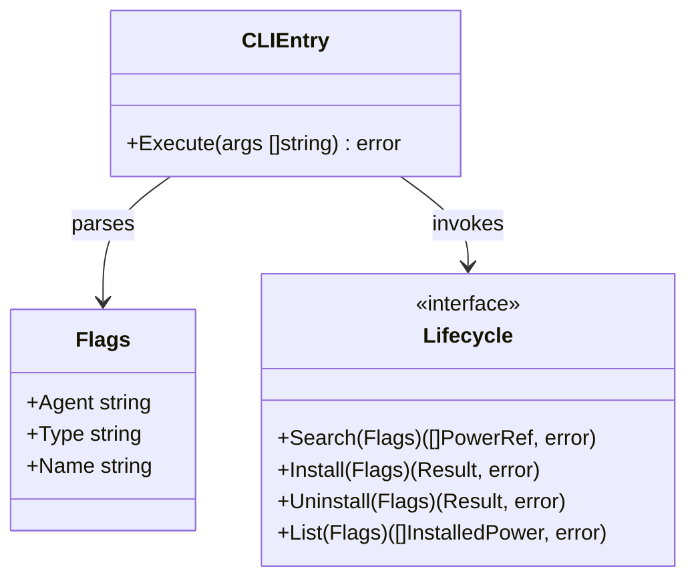
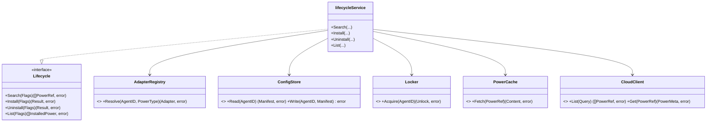
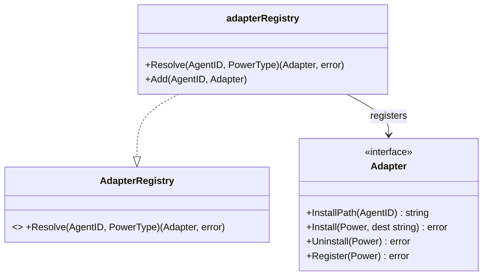
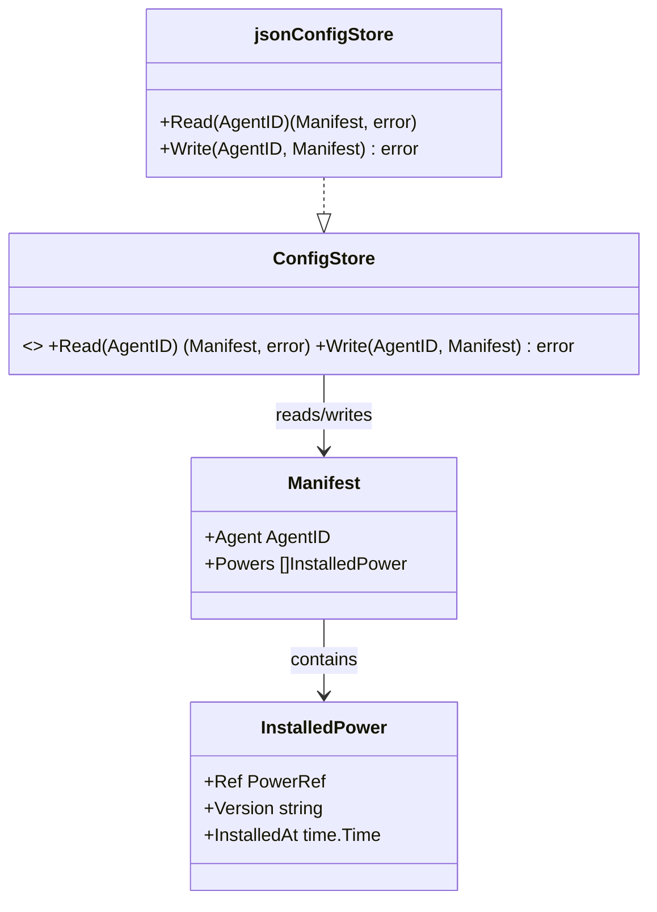
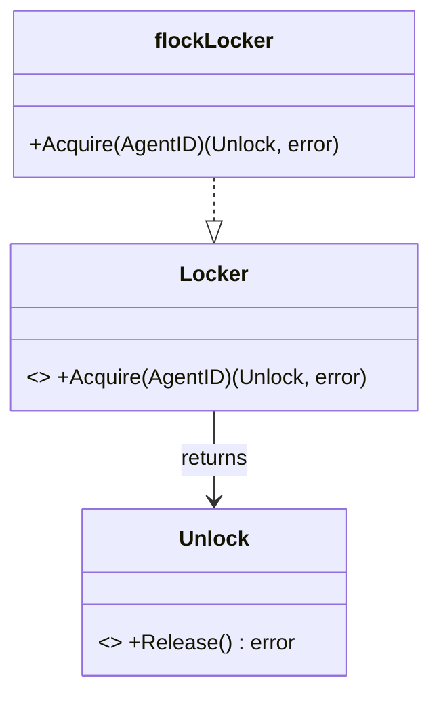
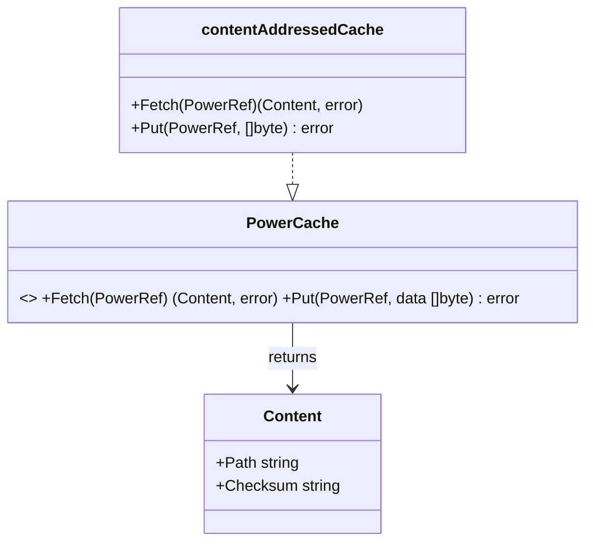
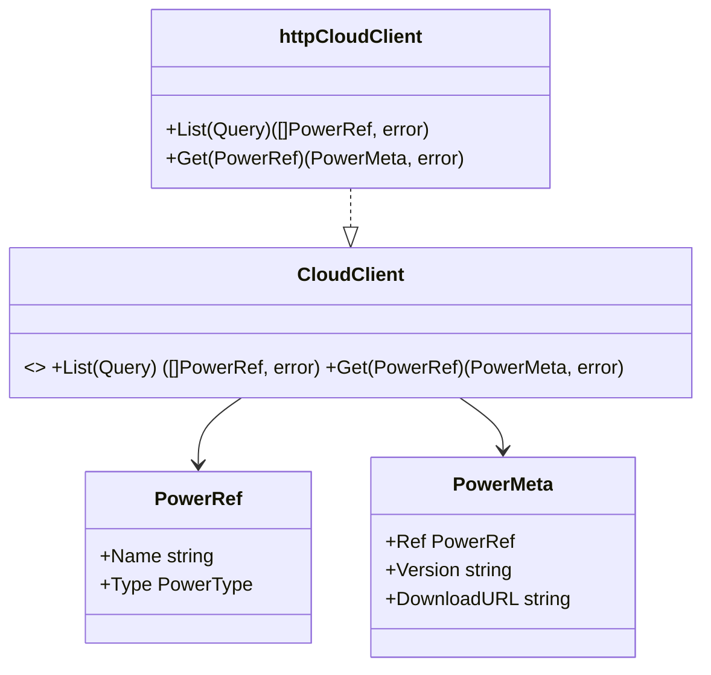

# APM CLI Component 类图设计

## 背景

`ivory-tower/c4/components/apm_cli.dsl` 定义了 `cli` 容器内的 7 个 C4 component（`cliEntry`、`lifecycle`、`adapterRegistry`、`configModel`、`lockManager`、`cacheManager`、`cloudClient`）。C4 组件图只表达职责边界和调用关系，不表达每个组件内部的主要对象和公开接口。本设计为每个 component 补充一张 Mermaid 类图，仅包含主要对象（接口 + 一个主要实现结构体）和功能接口（方法签名），用于更直观地表达内部结构，不涉及完整实现细节。

## 嵌入机制

Structurizr DSL 的限制决定了具体做法：

- `!docs`/`documentation` 只能挂在 workspace / softwareSystem / container 级别，无法挂到单个 component 上。
- `properties` 可以挂在任意元素（包括 component）上，但只支持单行字符串，[无原生多行字符串语法](https://github.com/structurizr/dsl/issues/137)。

因此采用「property 存相对路径，内容存独立文件」的方案：

- 新建目录 `ivory-tower/c4/components/apm_cli-diagrams/`，每个 component 一个 `.mmd` 文件（纯 Mermaid 源码，不套 Markdown fence）。
- 在 `apm_cli.dsl` 的每个 `component "..."` 定义块内增加：
  ```
  properties {
      "classDiagram" "apm_cli-diagrams/<file>.mmd"
  }
  ```
  路径相对于 `apm_cli.dsl` 所在目录。
- Structurizr Local 的 Properties 面板会显示这个路径（纯文本，不跳转、不渲染）；查看实际类图需要用支持 Mermaid 的编辑器/查看器直接打开对应 `.mmd` 文件。

## 文件清单

| Component 标识符 | 文件 |
| --- | --- |
| `cliEntry` | `cli-entry.mmd` |
| `lifecycle` | `core-lifecycle.mmd` |
| `adapterRegistry` | `adapter-registry.mmd` |
| `configModel` | `config-model.mmd` |
| `lockManager` | `lock-manager.mmd` |
| `cacheManager` | `cache-manager.mmd` |
| `cloudClient` | `cloud-client.mmd` |

## 共享领域类型

各图按需引用、不重复展开字段：

- `PowerRef { Name string; Type PowerType }`
- `PowerType`（skill / plugin / mcp 枚举）
- `AgentID`（具体 Agent 标识或字面量 `all`）

## 类图内容

### CLI Entry（`cli-entry.mmd`）



### Core Lifecycle（`core-lifecycle.mmd`）



### Adapter Registry（`adapter-registry.mmd`）



### Config Model（`config-model.mmd`）



### Lock Manager（`lock-manager.mmd`）



### Cache Manager（`cache-manager.mmd`）



### Cloud Client（`cloud-client.mmd`）



## 已知限制

- Structurizr Local 不会渲染这些图，仅显示 property 里的文件路径字符串；已与用户确认接受此限制。
- 图中方法签名与字段是为表达架构直观性而设计的示意接口，非最终 Go 代码；实现阶段可能调整具体命名。

## 范围

仅覆盖 `apm_cli.dsl` 现有的 7 个 component 的类图与其在 DSL 中的挂载方式，不改动 C4 的 System Context / Container 视图，也不涉及实际 Go 代码实现。
