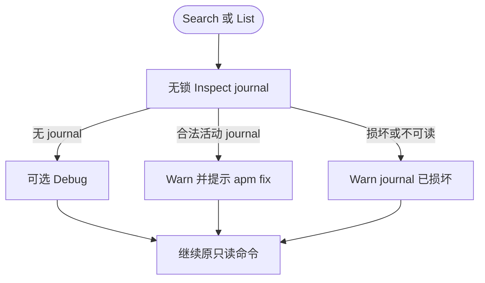

# Lifecycle Fix and Read-Only Journal Inspection Implementation Plan

> **For agentic workers:** REQUIRED SUB-SKILL: Use superpowers:subagent-driven-development (recommended) or superpowers:executing-plans to implement this plan task-by-task. Steps use checkbox (`- [ ]`) syntax for tracking.

**Goal:** Add an explicit `apm fix` command that performs one locked recovery while changing Search and both List modes to make an unlocked, non-mutating journal inspection that warns and continues.

**Architecture:** Keep journal parsing and validation inside `transaction.Service`, expose separate `Inspector` and `Recoverer` contracts, and share one private active-journal inspection path between `Inspect` and `Recover`. Search/List consume only the read-only contract and never acquire the global lock; Fix consumes only the recovery contract and owns the same lock boundary as Install/Uninstall recovery.

**Tech Stack:** Go 1.26.5, Cobra, `log/slog`, `gofrs/flock`, standard `testing`, repository-local Mermaid/C4/ADR documentation.

## Global Constraints

- The approved source of truth is `ivory-tower/features/016-lifecycle-fix/spec.md`.
- `apm fix` accepts exactly zero positional arguments, defines no command-specific flags, inherits only global `--verbose`, calls Recover once, and writes no business output to stdout.
- Search, default List, and Installed List perform Inspect without acquiring the global APM lock and continue after every Inspect error.
- A valid active journal produces `transaction recovery required` with `hint="run apm fix"`; an unreadable or invalid journal produces `transaction journal is damaged` without that hint.
- Read-only results are best-effort observations, not a globally consistent snapshot across journal, Agents, manifests, targets, or Agent CLI state.
- Install and Uninstall keep their current single-lock Recover, fail-fast, transaction, logging, result, and renderer semantics.
- Preserve schema v1, filesystem/agent-cli/plugin drivers, payloads, phases, recovery directions/actions, error sentinels, manifest rules, Agent order, CLI argv, and filesystem paths.
- Do not add force deletion, schema bypass, direction selection, Agent/Power filtering, multiple-journal recovery, or original-command replay to Fix.
- Important interfaces and business flows require concise, normative Chinese comments.
- MCP/Plugin tests must isolate `APM_HOME`, Cache, Agent homes, and PATH under `t.TempDir()` and must not execute real Agent CLIs.
- Use `apply_patch` for source and documentation edits; preserve unrelated user changes.
- Add exactly one `docs/Changelog.md` entry only after implementation, documentation, review, and full verification are complete; the Changelog commit does not list itself.

---

## File Structure Map

### New production files

| File | Responsibility |
| --- | --- |
| `internal/transaction/inspection.go` | Public read-only inspection contract/result and the single private active-journal inspection primitive. |
| `internal/lifecycle/journal_inspection.go` | Non-mutating Search/List inspection logging policy. |
| `internal/lifecycle/fix.go` | Locked one-shot recovery lifecycle. |
| `internal/cli/fix_contract.go` | CLI-owned Fix port and factory. |
| `internal/cli/fix.go` | Cobra Fix command and zero-argument invocation. |

### New test files

| File | Responsibility |
| --- | --- |
| `internal/transaction/inspection_test.go` | Inspect result, validation, error, and no-write coverage. |
| `internal/lifecycle/journal_inspection_test.go` | Read-only Debug/Warn policy and non-fatal errors. |
| `internal/lifecycle/fix_test.go` | Fix lock/recover/release ordering and error joins. |
| `internal/cli/fix_contract_test.go` | Fix marker/factory interface contracts. |
| `internal/cli/fix_test.go` | Fix Cobra parsing, construction, invocation, output, and errors. |

### Existing code files changed

| File | Responsibility after the change |
| --- | --- |
| `internal/transaction/manager.go` | Compose `Inspector`, `Recoverer`, and existing Power transaction methods. |
| `internal/transaction/recovery.go` | Recover from the Journal returned by the shared private inspection path. |
| `internal/transaction/journal_store.go` | Document strict Store inspection requirements. |
| `internal/lifecycle/search.go` | Inspect without locking, then query Cloud. |
| `internal/lifecycle/list.go` | Inspect before both Cloud and Installed branches. |
| `internal/lifecycle/list_installed.go` | Refresh/read manifests without lock, Recover, or Release gate. |
| `internal/cli/root.go` | Hold and register five command-specific lifecycle factories. |
| `cmd/apm/main.go` | Construct Inspector-backed Search/List and Recoverer-backed Fix. |

### Existing tests changed

`internal/transaction/recovery_test.go`, `internal/lifecycle/search_test.go`, `internal/lifecycle/list_test.go`, `internal/lifecycle/list_installed_test.go`, `internal/lifecycle/install_test_helpers_test.go`, `internal/lifecycle/uninstall_test_helpers_test.go`, `internal/lifecycle/mcp_integration_test.go`, `internal/lifecycle/plugin_integration_test.go`, all five existing `internal/cli/*_test.go` constructor users, and `cmd/apm/main_test.go`.

### Current documentation changed

`ivory-tower/adr/ADR-003-serialize-lifecycle-and-recover-journal.md`, ADR-004, ADR-009, Feature 007/008/009 current specs and overviews, `ivory-tower/project-overview.md`, `BUILD.md`, the current C4 DSL/diagrams, and finally `docs/Changelog.md`. Historical feature plans and old brainstorming documents remain unchanged and are superseded through current specs.

---

### Task 1: Introduce one shared Transaction inspection path

**Files:**
- Create: `internal/transaction/inspection.go`
- Create: `internal/transaction/inspection_test.go`
- Modify: `internal/transaction/manager.go:13-24,104-145`
- Modify: `internal/transaction/recovery.go:9-39`
- Modify: `internal/transaction/journal_store.go:3-9`
- Modify: `internal/transaction/recovery_test.go`
- Modify: `internal/lifecycle/install_test_helpers_test.go`
- Modify: `internal/lifecycle/uninstall_test_helpers_test.go`
- Modify: `internal/lifecycle/search_test.go`
- Modify: `internal/lifecycle/list_test.go`

**Interfaces:**
- Consumes: `JournalStore.Inspect() (Journal, bool, error)`, `validateJournal(Journal) error`, existing `RecoveryResult` and `Service` dependencies.
- Produces:

```go
type Inspector interface {
    Inspect(context.Context) (InspectionResult, error)
}

type Recoverer interface {
    Recover(context.Context) (RecoveryResult, error)
}

type InspectionResult struct {
    Active        bool
    TransactionID string
    Operation     Operation
    Agent         domain.AgentID
    Power         domain.PowerRef
    OriginalPhase Phase
}
```

- `Manager` embeds `Inspector` and `Recoverer` before the existing Skill/MCP/Plugin methods.
- Private `inspectActiveJournal(context.Context) (Journal, InspectionResult, error)` performs exactly one Store read and the shared validation/projection.

- [ ] **Step 1: Write failing Inspect tests**

Add table-driven tests with explicit Store call counts and mutations:

```go
func TestInspectReportsActiveJournalWithoutMutation(t *testing.T) {
    fixture := newRecoveryFixture(t)
    journal := validInstallJournal(fixture)
    fixture.journals.current = journal
    fixture.journals.found = true

    got, err := fixture.service.Inspect(context.Background())
    if err != nil {
        t.Fatal(err)
    }
    want := InspectionResult{
        Active: true, TransactionID: journal.TransactionID,
        Operation: journal.Operation, Agent: journal.Agent,
        Power: journal.Power, OriginalPhase: journal.Phase,
    }
    if !reflect.DeepEqual(got, want) {
        t.Fatalf("Inspect() = %#v, want %#v", got, want)
    }
    if fixture.journals.inspectCalls != 1 || fixture.journals.updateCalls != 0 || fixture.journals.deleteCalls != 0 {
        t.Fatalf("journal calls = inspect %d update %d delete %d", fixture.journals.inspectCalls, fixture.journals.updateCalls, fixture.journals.deleteCalls)
    }
}
```

Add separate tests for no journal, Store error, fake Store returning an invalid schema/driver/phase, `errors.Is(err, ErrInvalidJournal)`, and zero partial metadata on failure.

- [ ] **Step 2: Run focused tests and verify the red state**

Run:

```bash
go test -count=1 ./internal/transaction -run 'TestInspect'
```

Expected: compile failure because `Service.Inspect`, `InspectionResult`, and the new interfaces do not exist.

- [ ] **Step 3: Implement the interfaces, result, and private inspection primitive**

Create `inspection.go` with the approved projection and no mutation:

```go
func (s *Service) Inspect(ctx context.Context) (InspectionResult, error) {
    _, result, err := s.inspectActiveJournal(ctx)
    return result, err
}

func (s *Service) inspectActiveJournal(_ context.Context) (Journal, InspectionResult, error) {
    if isNilInterface(s.journals) {
        return Journal{}, InspectionResult{}, fmt.Errorf("inspect transaction with nil journal store: %w", ErrInvalidRequest)
    }
    journal, found, err := s.journals.Inspect()
    if err != nil {
        return Journal{}, InspectionResult{}, fmt.Errorf("inspect active transaction: %w", err)
    }
    if !found {
        return Journal{}, InspectionResult{}, nil
    }
    if err := validateJournal(journal); err != nil {
        return Journal{}, InspectionResult{}, err
    }
    result := InspectionResult{
        Active: true, TransactionID: journal.TransactionID,
        Operation: journal.Operation, Agent: journal.Agent,
        Power: journal.Power, OriginalPhase: journal.Phase,
    }
    return journal, result, nil
}
```

Keep the context parameter for the public contract and shared call path; document that the local Store read is synchronous and cannot be forcibly canceled. Keep Recover's existing `ctx.Err()` check before mutation.

- [ ] **Step 4: Make Recover consume the same one-read result**

Replace its direct Store read and duplicate result projection with:

```go
journal, inspection, err := s.inspectActiveJournal(ctx)
if err != nil {
    return RecoveryResult{}, recoveryError(err)
}
if !inspection.Active {
    return RecoveryResult{}, nil
}
result := RecoveryResult{
    TransactionID: inspection.TransactionID,
    Operation: inspection.Operation,
    Agent: inspection.Agent,
    Power: inspection.Power,
    OriginalPhase: inspection.OriginalPhase,
}
```

Retain the manifest dependency check, context check, driver switch, error wrapping, `Recovered=true`, and all power-specific recovery functions unchanged. Update the `JournalStore` comment to require strict decode/validation and retain the Service boundary validation for alternate injected Stores.

- [ ] **Step 5: Update Manager fakes to satisfy the aggregate interface**

Add an inert method to install/uninstall helpers and temporary Search/List fakes so the repository compiles before later tasks migrate read-only services to `Inspector`:

```go
func (f *fakeTransactions) Inspect(context.Context) (transaction.InspectionResult, error) {
    return f.inspection, f.inspectErr
}
```

Do not alter the existing Recover call recording or transaction behavior.

- [ ] **Step 6: Run focused and package tests**

Run:

```bash
go test -count=1 ./internal/transaction
go test -count=1 ./internal/lifecycle
```

Expected: PASS; existing Recover tests still prove direction/actions and the new tests prove one read and no writes.

- [ ] **Step 7: Commit the Transaction contract**

```bash
git add internal/transaction internal/lifecycle/*test*.go
git commit -m "feat(transaction): separate journal inspection from recovery"
```

---

### Task 2: Make Search inspect and warn without locking

**Files:**
- Create: `internal/lifecycle/journal_inspection.go`
- Create: `internal/lifecycle/journal_inspection_test.go`
- Modify: `internal/lifecycle/search.go:3-89`
- Modify: `internal/lifecycle/search_test.go`
- Modify: `internal/lifecycle/mcp_integration_test.go`
- Modify: `internal/lifecycle/plugin_integration_test.go`

**Interfaces:**
- Consumes: `transaction.Inspector.Inspect(context.Context) (transaction.InspectionResult, error)` and `cloud.Client.List()`.
- Produces: `inspectJournal(ctx context.Context, command string, inspector transaction.Inspector)` and `NewSearch(inspector transaction.Inspector, cloud cloud.Client)`.

- [ ] **Step 1: Write failing logging-policy tests**

Create an Inspector fake and assert all three branches:

```go
func TestInspectJournalWarnsRecoveryRequiredAndContinues(t *testing.T) {
    inspector := &fakeInspector{result: transaction.InspectionResult{
        Active: true, Operation: transaction.OperationInstall,
        Agent: domain.AgentCodex,
        Power: domain.PowerRef{Type: domain.PowerTypeSkill, Name: "demo", Version: "v1.0.0"},
        OriginalPhase: transaction.PhasePublishing,
    }}
    inspectJournal(context.Background(), "search", inspector)
    // Assert one Inspect call and WARN fields including hint="run apm fix".
}
```

Add explicit tests for verbose no-journal Debug and damaged journal Warn with the full error but without `run apm fix`. The helper must not return an error.

- [ ] **Step 2: Write failing Search ordering tests**

Replace the old Recover/Locker expectation with:

```go
wantCalls := []string{"inspect", "cloud-list"}
```

Add a damaged-inspection case whose expected calls remain `inspect, cloud-list` and whose returned Search result/Cloud error is unchanged. Remove lock acquisition/release error cases because Search no longer owns a Locker.

- [ ] **Step 3: Run Search tests and verify the red state**

```bash
go test -count=1 ./internal/lifecycle -run 'Test(InspectJournal|Search)'
```

Expected: compile or assertion failure because Search still calls Recover under a lock.

- [ ] **Step 4: Implement the shared read-only warning helper**

Implement exactly one Inspect call:

```go
func inspectJournal(ctx context.Context, command string, inspector transaction.Inspector) {
    result, err := inspector.Inspect(ctx)
    if err != nil {
        slog.Warn("transaction journal is damaged", slog.String("command", command), slog.Any("error", err))
        return
    }
    if !result.Active {
        slog.Debug("no active transaction before read-only command", slog.String("command", command))
        return
    }
    slog.Warn("transaction recovery required",
        slog.String("command", command),
        slog.String("operation", string(result.Operation)),
        logging.Agent(result.Agent), logging.Power(result.Power.Name),
        logging.Version(result.Power.Version),
        logging.Phase(string(result.OriginalPhase)),
        slog.String("hint", "run apm fix"),
    )
}
```

- [ ] **Step 5: Remove Search's lock/recovery boundary**

Change the service to:

```go
type SearchService struct {
    inspector transaction.Inspector
    cloud     cloud.Client
}

func NewSearch(inspector transaction.Inspector, cloud cloud.Client) (*SearchService, error)
```

In `Search`, call `inspectJournal(ctx, "search", s.inspector)` before Cloud List. Delete `recoverSearch`, Locker imports/field, RecoveryResult logging, and release error branches. Keep filter/sort/result behavior unchanged.

- [ ] **Step 6: Update integration expectations without introducing Fix yet**

Rename the MCP/Plugin Search recovery tests to state that Search reports but preserves an interrupted journal. After Search:

```go
if _, found, err := journalStore.Inspect(); err != nil || !found {
    t.Fatalf("Search must preserve the active journal: found=%v err=%v", found, err)
}
```

Assert no target/manifest recovery action occurred and the warning includes `run apm fix`.

- [ ] **Step 7: Run package tests and commit**

```bash
go test -count=1 ./internal/lifecycle -run 'Test(InspectJournal|Search|MCPIntegrationSearch|PluginIntegrationSearch)'
go test -count=1 ./internal/lifecycle
git add internal/lifecycle
git commit -m "refactor(search): inspect journal without recovery lock"
```

Expected: PASS.

---

### Task 3: Make both List modes inspect and run without locking

**Files:**
- Modify: `internal/lifecycle/list.go:3-60`
- Modify: `internal/lifecycle/list_installed.go:3-114`
- Modify: `internal/lifecycle/list_test.go`
- Modify: `internal/lifecycle/list_installed_test.go`

**Interfaces:**
- Consumes: Task 2 `inspectJournal`, `transaction.Inspector`, existing Cloud/Registry/Config contracts.
- Produces: `NewList(inspector transaction.Inspector, cloud cloud.Client, registry AdapterRegistry, config config.Repository)` with no Locker or Recover dependency.

- [ ] **Step 1: Write failing default List inspection tests**

Change the existing “Cloud branch touches no shared dependencies” assertion to the approved boundary:

```go
wantCalls := []string{"inspect", "cloud-list"}
```

Add active and damaged journal cases. Both must still return the same Cloud result/error, and neither may call Recover, Registry, Config, Acquire, or Release.

- [ ] **Step 2: Rewrite Installed List tests around the no-lock order**

The successful all-Agent order becomes:

```go
wantCalls := []string{"inspect", "refresh", "config:claude-code", "config:codex"}
```

Delete Release-specific expectations and cases. Preserve tests for concrete-Agent fatal errors, empty all snapshot, deterministic ordering, all-Agent partial failures, and non-nil empty results. Add active/damaged journal tests proving warning-then-continue.

- [ ] **Step 3: Run List tests and verify the red state**

```bash
go test -count=1 ./internal/lifecycle -run 'Test(List|NewList)'
```

Expected: failures because List still uses old constructor/lock/recovery flows.

- [ ] **Step 4: Change List service dependencies and top-level ordering**

Use:

```go
type ListService struct {
    inspector transaction.Inspector
    cloud     cloud.Client
    registry  AdapterRegistry
    config    config.Repository
}
```

Validate nil/typed-nil Inspector, Cloud, Registry, and Config in `NewList`. At the start of `List`, call:

```go
inspectJournal(ctx, "list", s.inspector)
```

Then select Installed versus Cloud. This makes both branches inspect exactly once.

- [ ] **Step 5: Remove Installed List's lock/recovery/release gate**

Delete `releaseInstalledList`, `logInstalledListRecovery`, Locker/Transaction logging imports, and all Acquire/Recover/Release calls. Keep this shape:

```go
snapshot, err := s.registry.RefreshInstalled()
// select Agents, read each Config, preserve concrete fatal and all partial behavior
result := makeInstalledListResult(flags, inputs)
if len(failures) != 0 {
    return result, &cli.PartialListError{Failures: failures}
}
return result, nil
```

- [ ] **Step 6: Run List and lifecycle regression tests**

```bash
go test -count=1 ./internal/lifecycle -run 'Test(List|NewList|InspectJournal)'
go test -count=1 ./internal/lifecycle
```

Expected: PASS; no production Search/List source contains `.Recover(`, `Acquire()`, or `Release()`.

- [ ] **Step 7: Commit the List migration**

```bash
git add internal/lifecycle/list*.go
git commit -m "refactor(list): use unlocked journal observation"
```

---

### Task 4: Add the locked one-shot Fix lifecycle

**Files:**
- Create: `internal/lifecycle/fix.go`
- Create: `internal/lifecycle/fix_test.go`

**Interfaces:**
- Consumes: `lock.Locker`, `transaction.Recoverer`, `transaction.RecoveryResult`.
- Produces: `NewFix(locker lock.Locker, recoverer transaction.Recoverer) (*FixService, error)` and `Fix(context.Context) error`.

- [ ] **Step 1: Write failing constructor and sequence tests**

Use dedicated fakes rather than the full Manager:

```go
type fixFakeRecoverer struct {
    calls  *[]string
    result transaction.RecoveryResult
    err    error
}

func (f *fixFakeRecoverer) Recover(context.Context) (transaction.RecoveryResult, error) {
    *f.calls = append(*f.calls, "recover")
    return f.result, f.err
}
```

Test nil and typed-nil Locker/Recoverer. For success assert `acquire, recover, release`, exactly one Recover call, one recovery Warn before Release, and no stdout.

- [ ] **Step 2: Add failing error-matrix tests**

Cover these exact calls and causes:

| Case | Calls | Expected error |
| --- | --- | --- |
| Acquire fails | `acquire` | acquire cause |
| Recover fails | `acquire,recover,release` | recover cause |
| Release fails after no journal | `acquire,recover,release` | release cause |
| Recover and Release fail | `acquire,recover,release` | `errors.Is` both causes |
| Recovery succeeds and Release fails | `acquire,recover,release` | release cause; Warn remains |

- [ ] **Step 3: Run tests and verify the red state**

```bash
go test -count=1 ./internal/lifecycle -run 'Test(NewFix|Fix)'
```

Expected: compile failure because Fix lifecycle does not exist.

- [ ] **Step 4: Implement Fix with one lock interval**

Use an explicit release helper:

```go
func (s *FixService) Fix(ctx context.Context) error {
    unlock, err := s.locker.Acquire()
    if err != nil {
        return fmt.Errorf("acquire fix lock: %w", err)
    }
    result, recoverErr := s.recoverer.Recover(ctx)
    if recoverErr == nil {
        logFixRecovery(result)
    }
    if releaseErr := unlock.Release(); releaseErr != nil {
        return errors.Join(recoverErr, fmt.Errorf("release fix lock: %w", releaseErr))
    }
    if recoverErr != nil {
        return fmt.Errorf("recover transaction for fix: %w", recoverErr)
    }
    return nil
}
```

Avoid returning a bare Recover error before Release. Ensure the single-error path adds Fix context while the joined path retains both causes. `logFixRecovery` uses the existing recovery Warn fields and a no-journal Debug.

- [ ] **Step 5: Run tests and commit**

```bash
go test -count=1 ./internal/lifecycle -run 'Test(NewFix|Fix)'
go test -count=1 ./internal/lifecycle
git add internal/lifecycle/fix.go internal/lifecycle/fix_test.go
git commit -m "feat(lifecycle): add one-shot journal fix"
```

Expected: PASS.

---

### Task 5: Add the Fix CLI and default dependency wiring

**Files:**
- Create: `internal/cli/fix_contract.go`
- Create: `internal/cli/fix_contract_test.go`
- Create: `internal/cli/fix.go`
- Create: `internal/cli/fix_test.go`
- Modify: `internal/cli/root.go:1-93`
- Modify: `internal/cli/cli_test.go`
- Modify: `internal/cli/search_test.go`
- Modify: `internal/cli/list_test.go`
- Modify: `internal/cli/install_test.go`
- Modify: `internal/cli/uninstall_test.go`
- Modify: `cmd/apm/main.go:18-132`
- Modify: `cmd/apm/main_test.go`

**Interfaces:**
- Consumes: Task 4 `lifecycle.NewFix`, Task 2/3 `NewSearch`/`NewList`, existing root logging/error behavior.
- Produces: `FixLifecycle`, `FixLifecycleFactory`, `newFixCommand`, fifth `CLIEntry` factory, and `newFixLifecycle` in `cmd/apm`.

- [ ] **Step 1: Write failing Fix CLI contract tests**

Define the exact port:

```go
type recordingFixLifecycle struct {
    calls int
    err   error
}

func (f *recordingFixLifecycle) Fix(context.Context) error {
    f.calls++
    return f.err
}
```

Test `apm fix` invokes once, stdout is empty, `apm fix extra` fails before factory creation, unknown `--agent`/`--type` fails, `--verbose fix` initializes verbose logging, factory error is wrapped as `create fix lifecycle`, nil/typed-nil service fails, and service error reaches the single Error/usage path.

- [ ] **Step 2: Run CLI tests and verify the red state**

```bash
go test -count=1 ./internal/cli -run 'TestFix'
```

Expected: compile failure because Fix CLI types and command are absent.

- [ ] **Step 3: Implement the Fix contract and Cobra command**

Create:

```go
type FixLifecycle interface {
    Fix(context.Context) error
}

type FixLifecycleFactory func() (FixLifecycle, error)
```

The command uses `Use: "fix"`, `Short: "Recover an interrupted transaction"`, `Args: cobra.ExactArgs(0)`, calls `logParsedCommand`, validates factory/service, and returns `service.Fix(command.Context())`. It has no renderer and binds no flags.

- [ ] **Step 4: Add the fifth factory without changing existing command semantics**

Extend `CLIEntry`, `New`, `Execute`, and `newRootCommand`; register:

```go
root.AddCommand(
    newSearchCommand(newSearchLifecycle),
    newListCommand(newListLifecycle),
    newInstallCommand(newInstallLifecycle),
    newUninstallCommand(newUninstallLifecycle),
    newFixCommand(newFixLifecycle),
)
```

Update every test helper calling `cli.New` with an explicit Fix factory or nil only when the test intentionally covers missing Fix creation. Assert existing commands never construct Fix.

- [ ] **Step 5: Wire default factories**

In `main.go`:

```go
func newFixLifecycle() (cli.FixLifecycle, error) {
    locker, err := lock.NewDefault()
    // create repository, Registry, transaction Manager as existing write factories do
    return lifecycle.NewFix(locker, transactions)
}
```

Change Search/List construction to pass the Transaction Service as Inspector but no Locker:

```go
return lifecycle.NewSearch(transactions, cloudClient)
return lifecycle.NewList(transactions, cloudClient, registry, repository)
```

Add Fix to the default-factory construction test and an isolated `APM_HOME` test proving `newFixLifecycle().Fix(ctx)` recovers a real interrupted journal or returns success with no journal.

- [ ] **Step 6: Run CLI and cmd tests**

```bash
go test -count=1 ./internal/cli
go test -count=1 ./cmd/apm
go test -count=1 ./internal/lifecycle
```

Expected: PASS; `apm fix` has no stdout and the help tree contains all five commands.

- [ ] **Step 7: Commit the CLI and wiring**

```bash
git add internal/cli cmd/apm
git commit -m "feat(cli): expose explicit fix command"
```

---

### Task 6: Complete recovery integration and behavior-regression coverage

**Files:**
- Modify: `internal/lifecycle/mcp_integration_test.go`
- Modify: `internal/lifecycle/plugin_integration_test.go`
- Create: `internal/lifecycle/fix_integration_test.go`
- Modify: any focused fake/helper files required by exact interface compilation, without changing production behavior.

**Interfaces:**
- Consumes: Tasks 1–5 production behavior.
- Produces: end-to-end proof that read-only commands preserve journals and Fix performs the same cross-driver recovery previously triggered by Search.

- [ ] **Step 1: Add failing cross-driver Fix integration cases**

For filesystem Skill, agent-cli MCP, marketplace Plugin, and Hermes filesystem Plugin, create an interrupted schema-v1 journal under a temporary APM home, then execute:

```go
searchResult, err := search.Search(ctx, searchFlags)
// Assert query succeeds, warning is present, journal still exists, and target/manifest is unchanged.

if err := fixer.Fix(ctx); err != nil {
    t.Fatal(err)
}
// Assert journal is absent and expected commit/rollback state is converged.
```

Each test records Recover call count or observable CLI calls to prove exactly one recovery attempt.

- [ ] **Step 2: Add damaged-journal read-only versus Fix behavior**

Write invalid JSON and an invalid schema-v1 envelope to `transactions/active.json`. Search and both List modes must warn and continue without changing bytes. Fix must return an error satisfying both `ErrRecoveryFailed` and `ErrInvalidJournal`, and the bytes must remain identical.

- [ ] **Step 3: Prove real Agent environments are isolated**

Reuse the integration harness variables:

```text
APM_HOME, XDG_CACHE_HOME, CODEX_HOME,
CLAUDE_CONFIG_DIR, HERMES_HOME, PATH=<temp>/fake-bin
```

Assert every recorded executable path is inside fake-bin and all journal/manifest/target paths are under the temporary root.

- [ ] **Step 4: Run integration and race-focused tests**

```bash
go test -count=1 -v ./internal/lifecycle -run 'Test(Fix|MCP|Plugin|Search|List)'
go test -race -count=1 ./internal/transaction ./internal/lifecycle ./internal/cli
```

Expected: PASS; no test calls `/home/liangff/.local/bin/hermes` or any real Agent CLI.

- [ ] **Step 5: Run static behavior-boundary checks**

```bash
! rg -n '\.Recover\(|Acquire\(|\.Release\(' internal/lifecycle/search.go internal/lifecycle/list.go internal/lifecycle/list_installed.go
rg -n '\.Inspect\(' internal/lifecycle/search.go internal/lifecycle/list.go
rg -n 'Acquire\(|\.Recover\(|\.Release\(' internal/lifecycle/install.go internal/lifecycle/uninstall.go internal/lifecycle/fix.go
```

Expected: first command has no output; the other commands show the intended calls.

- [ ] **Step 6: Commit the integration coverage**

```bash
git add internal/lifecycle
git commit -m "test(fix): cover isolated cross-driver recovery"
```

---

### Task 7: Synchronize ADR, Feature, C4, and user documentation

**Files:**
- Modify: `ivory-tower/adr/ADR-003-serialize-lifecycle-and-recover-journal.md`
- Modify: `ivory-tower/adr/ADR-004-discover-installed-agents-before-local-operations.md`
- Modify: `ivory-tower/adr/ADR-009-centralize-lifecycle-transactions.md`
- Modify: `ivory-tower/features/007-central-lifecycle-transactions/spec.md`
- Modify: `ivory-tower/features/007-central-lifecycle-transactions/feature-overview.md`
- Modify: `ivory-tower/features/008-lifecycle-search/spec.md`
- Modify: `ivory-tower/features/008-lifecycle-search/feature-overview.md`
- Modify: `ivory-tower/features/009-lifecycle-list/spec.md`
- Modify: `ivory-tower/features/009-lifecycle-list/feature-overview.md`
- Modify: `ivory-tower/project-overview.md`
- Modify: `BUILD.md`
- Modify: `ivory-tower/c4/components/apm-cli.dsl`
- Modify: `ivory-tower/c4/components/apm-cli-diagrams/cli-entry.mmd`
- Modify: `ivory-tower/c4/components/apm-cli-diagrams/core-lifecycle.mmd`
- Modify: `ivory-tower/c4/components/apm-cli-diagrams/lock-manager.mmd`
- Modify: `ivory-tower/c4/components/apm-cli-lifecycle-diagrams/common-journal-recovery.mmd`
- Modify: `ivory-tower/c4/components/apm-cli-lifecycle-diagrams/search.mmd`
- Modify: `ivory-tower/c4/components/apm-cli-lifecycle-diagrams/list.mmd`
- Create: `ivory-tower/c4/components/apm-cli-lifecycle-diagrams/common-journal-inspection.mmd`
- Create: `ivory-tower/c4/components/apm-cli-lifecycle-diagrams/fix.mmd`

**Interfaces:**
- Consumes: verified code semantics from Tasks 1–6 and approved Feature 016 spec.
- Produces: one consistent current architecture narrative; historical plans remain unchanged.

- [ ] **Step 1: Revise ADR-003 as the authoritative decision**

Set `Revised: 2026-08-14` and replace old Search/Installed List recovery decisions with:

```text
Search/List: Inspect without lock → warn/debug → continue read-only business.
Fix: Acquire → Recover once → lock-held warn/debug → Release → exit.
Install/Uninstall: existing locked Recover and mutation flow unchanged.
```

Explicitly record best-effort observation, stale/missed warning races, cross-Agent mixed manifests, target/manifest mismatch windows, damaged-journal warning-and-continue, and why global consistency requires locking or MVCC and is intentionally not promised.

- [ ] **Step 2: Update dependent ADRs and Feature supersession notes**

ADR-004 must say Installed List refresh is unlocked and its snapshot is observational; Install/Uninstall remain locked. ADR-009 must define Manager's Inspect/Recover split and say lifecycle chooses non-mutating observation versus locked recovery.

Feature 007/008/009 specs and overviews receive dated Feature 016 supersession notes. Do not edit their historical `plan.md` files.

- [ ] **Step 3: Update current Project Overview and BUILD guide**

Add Fix to the current command list and examples:

```bash
./apm fix
./apm --verbose fix
```

Replace “next Search/installed List/Install/Uninstall recovers” with “Search/List warn; Fix/Install/Uninstall recover.” State that damaged journal cannot be auto-fixed and that read-only output is not globally consistent.

- [ ] **Step 4: Update C4 component and flow diagrams**

Add `fixLifecycle` and `journalInspection` properties in `apm-cli.dsl`. The new inspection flow must be:



The Fix diagram must show Acquire, one Recover, Warn/Debug, Release, error join, and exit. The common recovery diagram must apply only to Fix/Install/Uninstall. Search/List diagrams must contain no lock or Recover nodes.

- [ ] **Step 5: Scan for stale current semantics**

Run:

```bash
rg -n 'Search.*Recover|Search.*恢复|installed List.*Recover|list --installed.*Recover|下一条 Search|四条命令.*恢复' \
  ivory-tower/adr ivory-tower/features ivory-tower/c4 ivory-tower/project-overview.md BUILD.md
```

Expected: remaining matches are either explicitly labeled historical/superseded or describe the new “does not Recover” rule. Fix ambiguous current-tense matches before committing.

- [ ] **Step 6: Validate docs and commit**

```bash
git diff --check
git status --short
git add BUILD.md ivory-tower
git commit -m "docs(fix): define explicit recovery lifecycle"
```

Expected: PASS; only intended current documentation is staged.

---

### Task 8: Review, full verification, Changelog, and completion audit

**Files:**
- Modify after every other gate passes: `docs/Changelog.md`
- Inspect: every file named in Feature 016 spec and this plan.

**Interfaces:**
- Consumes: all previous task commits.
- Produces: reviewed, fully verified implementation and the single request-level Changelog record.

- [ ] **Step 1: Run a requirement-by-requirement audit before claiming completion**

Build a checklist from all eight Feature 016 acceptance conditions. For each item, cite direct evidence from source, focused tests, integration state, or documentation. Treat any missing/indirect evidence as unfinished work.

- [ ] **Step 2: Run self-review and request an independent code review**

Inspect:

```bash
git diff --check main...HEAD
git diff --stat main...HEAD
git log --oneline main..HEAD
```

Use `superpowers:requesting-code-review` against the complete implementation range. Fix every verified Critical/Important finding with focused regression tests, commit the fixes, and re-request review until no such finding remains.

- [ ] **Step 3: Run fresh final verification**

```bash
test -z "$(gofmt -l cmd internal)"
go test -count=1 ./...
go test -race -count=1 ./...
go vet ./...
verify_dir="$(mktemp -d)"
go build -o "$verify_dir/apm" ./cmd/apm
test -x "$verify_dir/apm"
git diff --check
```

Expected: every command exits 0 with current output, not an earlier run.

- [ ] **Step 4: Re-run isolated MCP/Plugin/Fix integration tests verbosely**

```bash
go test -count=1 -v ./internal/lifecycle -run 'Test(Fix|MCP|Plugin|Search|List)'
git status --short
```

Expected: PASS; worktree has only the pending Changelog edit or is clean, and recorded executables remain inside fake-bin.

- [ ] **Step 5: Add one Changelog entry after verification**

Use `/home/liangff/.codex/docs/Changelog.md` as the template. Add a top `2026-08-14` entry with:

- category `新增功能`;
- the user requirement for explicit Fix, locked write recovery, unlocked read-only inspection/warnings, and ADR consistency limits;
- every related spec, plan, implementation, test, fix, and documentation commit except the Changelog commit itself;
- exact verification commands and fake-Agent isolation result;
- the limitation that damaged journals are warned about but cannot be auto-recovered.

- [ ] **Step 6: Commit Changelog and revalidate the merged commit set**

```bash
git add docs/Changelog.md
git commit -m "docs(changelog): record explicit fix lifecycle"
git diff --check HEAD^
go test -count=1 ./...
git status --short --branch
```

Expected: PASS and a clean feature branch.

- [ ] **Step 7: Complete the branch using the finishing workflow**

Use `superpowers:verification-before-completion` before any success claim, then `superpowers:finishing-a-development-branch`. Present the required merge/PR/keep options unless the user has already explicitly selected an integration method for this feature. Do not delete or merge unverified work.
